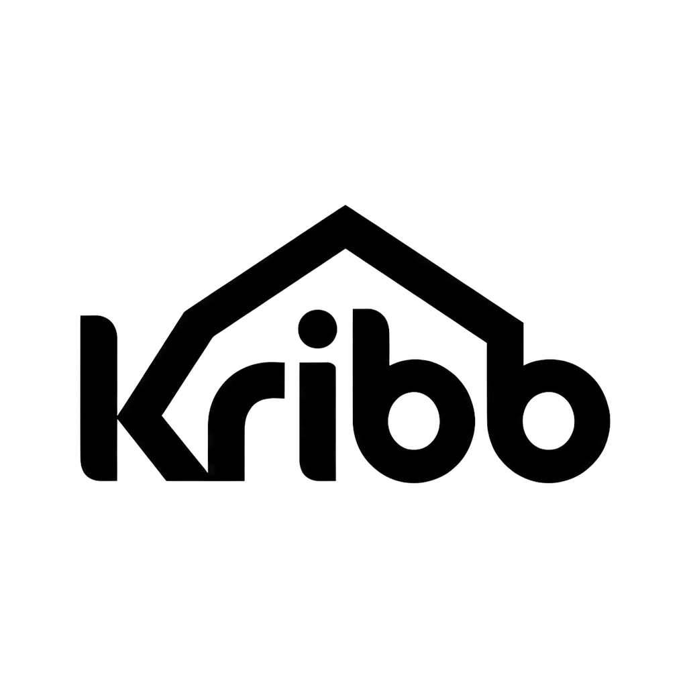

<div align="center">
  
  <h1>🏡 Kribb — Real Estate Mobile App</h1>
  <p><strong>A modern, full-stack cross-platform real estate mobile application built with React Native 0.86, Expo SDK 57, Clerk, and Supabase.</strong></p>

  <p>
    <a href="https://expo.dev"></a>
    <a href="https://reactnative.dev"></a>
    <a href="https://react.dev"></a>
    <a href="https://clerk.com"></a>
    <a href="https://supabase.com"></a>
    <a href="https://nativewind.dev"></a>
    <a href="https://www.typescriptlang.org"></a>
  </p>
</div>

---

## 📌 Table of Contents

- [Overview](#-overview)
- [Key Features](#-key-features)
- [Tech Stack Architecture](#-tech-stack-architecture)
- [Project Architecture & Directory Structure](#-project-architecture--directory-structure)
- [Database Schema & Security (Supabase + Clerk)](#-database-schema--security-supabase--clerk)
- [Getting Started](#-getting-started)
  - [Prerequisites](#prerequisites)
  - [Environment Variables](#environment-variables)
  - [Installation](#installation)
  - [Running the App](#running-the-app)
- [Building Android APK (EAS Build)](#-building-android-apk-eas-build)
- [Engineering Highlights & What I Learned](#-engineering-highlights--what-i-learned)
- [License](#-license)

---

## 🌟 Overview

**Kribb** is a production-ready mobile application designed to simplify buying, renting, and listing real estate properties. Built with cutting-edge mobile architecture—featuring **React 19 with the experimental React Compiler**, **Expo SDK 57**, **NativeWind v4** for Tailwind styling, **Clerk** for modern authentication, and **Supabase** for relational data persistence, Row-Level Security (RLS), and media storage.

From interactive map coordinates to multi-photo uploads and optimistic wishlist toggles, Kribb is designed with attention to mobile UX, offline tolerance, and performance.

---

## ✨ Key Features

### 🔍 1. Property Discovery & Home Feed
- **Hero & Featured Carousel**: Dynamic horizontal carousel highlighting trending and featured real estate listings.
- **Recommended Grid**: High-performance vertical listings with lazy loading and pull-to-refresh (`RefreshControl`).
- **Time-Aware Personalized Greeting**: Contextual header greetings based on device local time (`Good Morning`, `Good Evening`).

### 🔎 2. Multi-Criteria Search & Filter System
- **Real-time Keyword Search**: Search properties by title, address, or city.
- **Filter Modal**: Granular multi-parameter filtering:
  - Property Type (`Apartment`, `House`, `Villa`, `Studio`)
  - Bedroom count stepper
  - Min/Max budget price bounds
- **Zustand Filter Store**: Centralized filter state with active filter badges and quick reset.

### 📍 3. Interactive Maps & Geolocation
- **In-App OpenStreetMap Preview**: Embedded lightweight map preview inside property details powered by `react-native-webview`.
- **Full-Screen Interactive Map**: Dedicated screen rendering exact bounding box with map markers.
- **Native Navigation Handoff**: One-tap deep linking to native **Google Maps** with exact latitude/longitude coordinates (`Linking.openURL`).
- **GPS Location Detection**: Auto-tags GPS coordinates for new listings via `expo-location`.

### 📸 4. Rich Media & Image Viewer
- **Image Carousel**: Swipeable image gallery for property listings.
- **Full-Screen Zoomable Viewer**: Pinch-to-zoom, high-definition modal viewer powered by `react-native-image-viewing`.
- **Multi-Image Picker**: Native gallery image picker (`expo-image-picker`) supporting up to 6 photos with base64/binary uploads directly to Supabase Storage.

### ❤️ 5. Wishlist / Saved Properties (Optimistic UI)
- **Instant Toggle**: Bookmark properties with instant UI response.
- **Optimistic Zustand Store**: Rolls back gracefully on network or auth failure.
- **User-Specific Persistence**: Synced with Supabase `saved_properties` table using Clerk user ID.

### 🔐 6. Secure Authentication & User Sync
- **Clerk Authentication**: Email/Password and social sign-in/sign-up flows with `expo-secure-store` token persistence.
- **Cross-Service JWT Bridge**: Decodes Clerk JWT claims, detects token expiration proactive buffer (15s), and signs authenticated requests to Supabase PostgREST endpoints.
- **Automatic User Sync**: Custom `useUserSync` hook syncing Clerk profile data to Supabase `users` table on first login.

### 🏢 7. Property Creation & Admin Management
- **List New Property**: Intuitive multi-step form with validation, price boundaries, bedroom/bathroom stepper, and device location detection.
- **Direct Agent Contact**: Quick WhatsApp message pre-fill and direct phone dialer integration.
- **Admin Permissions**: Role-based access control (`is_admin`) to mark properties as sold/available or delete listings.

---

## 🛠 Tech Stack Architecture

| Layer | Technology | Description |
|---|---|---|
| **Framework** | [React Native 0.86](https://reactnative.dev) + [Expo SDK 57](https://expo.dev) | Modern native runtime with New Architecture support |
| **Language** | [TypeScript 5.9](https://www.typescriptlang.org/) | End-to-end type safety |
| **Compiler** | [React 19](https://react.dev) + [React Compiler](https://react.dev/learn/react-compiler) | Auto-memoization and zero-boilerplate reactivity |
| **Routing** | [Expo Router v57](https://docs.expo.dev/router/introduction/) | File-based typed routes with route groups `(auth)`, `(tabs)` |
| **Styling** | [NativeWind v4](https://www.nativewind.dev/) (Tailwind CSS v3.4) | Utility-first responsive styling for native components |
| **Auth** | [Clerk Expo](https://clerk.com/docs) | Enterprise auth with OAuth, sessions, and secure storage |
| **Database** | [Supabase](https://supabase.com) (PostgreSQL) | Relational database with Row Level Security (RLS) |
| **Storage** | Supabase Storage | Cloud object storage for high-res property and avatar images |
| **State Management** | [Zustand v5](https://github.com/pmndrs/zustand) | Lightweight, predictable store for filters, user, & saved items |
| **Native APIs** | `expo-location`, `expo-image-picker`, `expo-secure-store` | Hardware GPS, camera/gallery permissions, encrypted keychain |
| **DevOps / CI** | [EAS (Expo Application Services)](https://expo.dev/eas) | Cloud and local Android APK generation (`eas.json`) |

---

## 📂 Project Architecture & Directory Structure

```text
RN_BY_RoadSideCoder/
├── assets/                  # App icons, splash screens, and illustrations
│   └── images/
│       ├── kribb-icon.png
│       └── kribb.png
├── components/              # Reusable UI components
│   ├── FeaturedCard.tsx     # Hero property card for home feed
│   ├── FilterModal.tsx      # Multi-criteria search filter bottom-sheet
│   └── PropertyCard.tsx     # Standard property listing card
├── hooks/                   # Custom business logic React hooks
│   ├── useSavedProperty.ts  # Bookmark toggle & optimistic updates
│   ├── useSupabase.ts       # Authenticated Supabase client hook
│   └── useUserSync.ts       # Clerk to Supabase profile sync hook
├── lib/                     # Utilities and backend client configuration
│   ├── supabase.ts          # Supabase client & Clerk JWT refresh handler
│   └── utils.ts             # Price formatting, date helpers, time greetings
├── store/                   # Zustand state stores
│   ├── filterStore.ts       # Search query & filter state
│   ├── savedStore.ts        # Wishlist state with optimistic persistence
│   └── userStore.ts         # User role & admin permission state
├── src/
│   └── app/                 # Expo Router file-based pages
│       ├── (auth)/          # Authentication flow route group
│       │   ├── _layout.tsx
│       │   ├── sign-in.tsx
│       │   └── sign-up.tsx
│       ├── (roots)/         # Protected application route group
│       │   ├── _layout.tsx
│       │   ├── (tabs)/      # Bottom tab navigation
│       │   │   ├── _layout.tsx
│       │   │   ├── index.tsx      # Home discover feed
│       │   │   ├── search.tsx     # Search & filter screen
│       │   │   ├── saved.tsx      # Bookmarked properties
│       │   │   ├── create.tsx     # Add listing form with GPS & uploads
│       │   │   └── profile.tsx    # User profile & account management
│       │   └── property/
│       │       ├── [id].tsx       # Dynamic property details screen
│       │       └── map.tsx        # Full-screen interactive map
│       ├── _layout.tsx      # Root provider layout (Clerk, fonts, Safe Area)
│       └── index.tsx        # App entry & splash redirection
├── Types/
│   └── index.ts             # Global TypeScript interfaces (Property, etc.)
├── app.json                 # Expo configuration & plugins
├── babel.config.js          # Babel presets (Expo + NativeWind)
├── eas.json                 # EAS build configuration (Preview APK)
├── global.css               # Tailwind CSS directives
├── package.json             # Project dependencies & scripts
└── tailwind.config.js       # NativeWind Tailwind theme configuration
```

---

## 🗄 Database Schema & Security (Supabase + Clerk)

### PostgreSQL Tables

#### `properties`
| Column | Type | Description |
|---|---|---|
| `id` | `uuid` (PK) | Unique property identifier |
| `title` | `text` | Property listing title |
| `description` | `text` | Detailed description |
| `price` | `numeric` | Listing price |
| `type` | `text` | Category (`apartment`, `house`, `villa`, `studio`) |
| `bedrooms` | `int` | Number of bedrooms |
| `bathrooms` | `int` | Number of bathrooms |
| `area_sqft` | `numeric` | Area in square feet |
| `address` | `text` | Street address |
| `city` | `text` | City name |
| `latitude` | `float8` | GPS latitude |
| `longitude` | `float8` | GPS longitude |
| `images` | `text[]` | Array of image URLs stored in Supabase Storage |
| `is_featured` | `boolean` | Flag for home carousel |
| `is_sold` | `boolean` | Status flag |
| `created_at` | `timestamptz`| Timestamp |

#### `saved_properties`
| Column | Type | Description |
|---|---|---|
| `id` | `uuid` (PK) | Unique bookmark ID |
| `user_id` | `text` | Clerk User ID (`clerk_id`) |
| `property_id`| `uuid` (FK) | Reference to `properties.id` |
| `created_at` | `timestamptz`| Timestamp |

#### `users`
| Column | Type | Description |
|---|---|---|
| `clerk_id` | `text` (PK) | Clerk unique user ID |
| `email` | `text` | Primary user email |
| `first_name`| `text` | First name |
| `last_name` | `text` | Last name |
| `avatar_url`| `text` | Profile image URL |
| `is_admin` | `boolean` | Admin status for property operations |

---

## 🚀 Getting Started

### Prerequisites

- [Node.js](https://nodejs.org/) (v18 or v20 LTS recommended)
- [npm](https://www.npmjs.com/) or [yarn](https://yarnpkg.com/)
- [Expo Go app](https://expo.dev/go) on your physical Android or iOS device (or an Android Emulator / iOS Simulator)
- A free [Clerk](https://clerk.com) account
- A free [Supabase](https://supabase.com) account

### Environment Variables

Create a `.env` file in the root directory:

```env
# Clerk Authentication
EXPO_PUBLIC_CLERK_PUBLISHABLE_KEY=pk_test_your_clerk_key

# Supabase Backend
EXPO_PUBLIC_SUPABASE_URL=https://your-project.supabase.co
EXPO_PUBLIC_SUPABASE_KEY=your_supabase_anon_public_key
```

### Installation

1. **Clone the repository:**
   ```bash
   git clone https://github.com/its-anuraj/kribb.git
   cd kribb
   ```

2. **Install dependencies:**
   ```bash
   npm install
   ```

### Running the App

Start the Expo development server:

```bash
npx expo start
```

- **Scan the QR code** using the **Expo Go** app on your Android device (or camera app on iOS).
- Press `a` to open in an Android Emulator.
- Press `i` to open in an iOS Simulator.
- Press `w` to run in web browser mode.

---

## 📦 Building Android APK (EAS Build)

The project includes pre-configured `eas.json` profiles for building standalone Android APKs:

1. **Install EAS CLI:**
   ```bash
   npm install -g eas-cli
   ```

2. **Login to Expo:**
   ```bash
   eas login
   ```

3. **Configure & Build Preview APK:**
   ```bash
   eas build --profile preview --platform android
   ```

Once the cloud build completes, download the installable `.apk` file directly onto any Android device!

---

## 🧠 Engineering Highlights & What I Learned

Building **Kribb** provided deep, hands-on mastery of full-stack mobile engineering:

1. **Expo Router & Modern Navigation**:
   - Mastered file-based routing in React Native, using nested layouts (`_layout.tsx`), group routes `(auth)` / `(roots)`, and dynamic parameters (`/property/[id]`).
   - Managed deep links and hardware Android back button interactions cleanly.

2. **Clerk + Supabase Cross-Service Authentication**:
   - Solved the real-world challenge of integrating third-party OAuth/Clerk sessions with Supabase PostgREST Row Level Security (RLS).
   - Implemented JWT inspection, clock-skew buffer handling, and automatic token refresh retries upon Postgres `PGRST303` errors.

3. **State Management with Zustand & Optimistic UI**:
   - Designed modular stores (`savedStore`, `filterStore`, `userStore`).
   - Implemented optimistic updates for instant bookmark feedback, with silent rollback on failure.

4. **Hardware & Native Device APIs**:
   - Integrated camera & gallery media picking with image compression and base64 cloud uploads.
   - Leveraged `expo-location` for real-time GPS coordinate extraction.
   - Built WebView-based OpenStreetMap previews and linked them directly into native Google Maps.

5. **React 19 & React Compiler**:
   - Gained early experience working with React 19 in React Native, exploring compiler-driven automatic memoization without unnecessary `useMemo` / `useCallback` boilerplate.

6. **DevOps & Production Builds**:
   - Solved peer dependency conflicts using `.npmrc` legacy flags.
   - Configured EAS cloud build pipelines for automated APK builds.

---

## 📄 License

This project is licensed under the [MIT License](LICENSE).

<div align="center">
  <sub>Built with ❤️ by Anuraj Indolia</sub>
</div>
